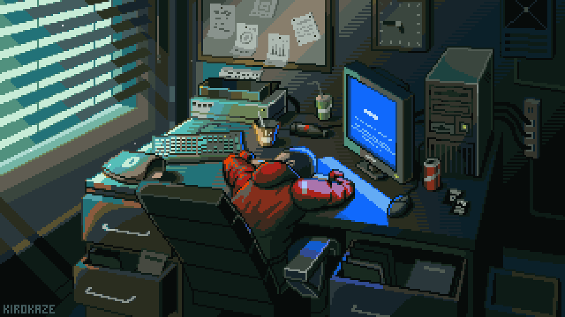
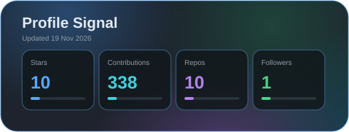
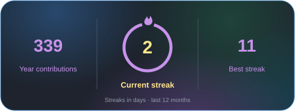
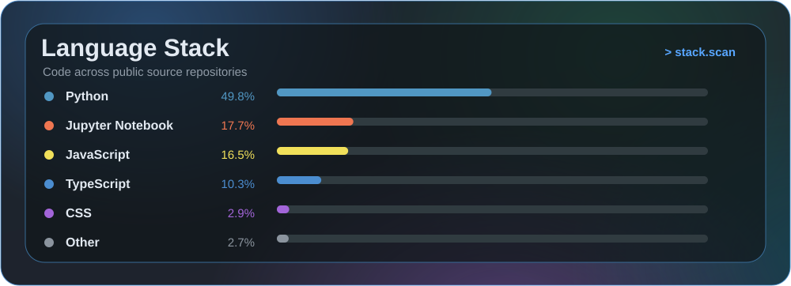
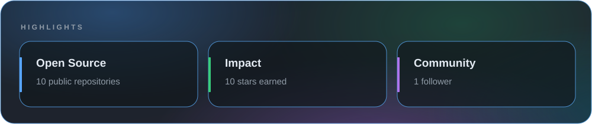

<h1 align="center">Hey 🧙‍♂️ I'm vittal-17</h1>

  

## 📌 About Me

> 💡 Full-stack developer building Python backends, AI-powered products, and automations that do the boring stuff for you.

## 📊 GitHub Stats & Activity

  
  

  

  

  

## 🛠️ Languages & Tools

> ### Programming Languages

  &nbsp;
  &nbsp;
  &nbsp;

> ### Frontend

  &nbsp;
  &nbsp;
  &nbsp;
  &nbsp;
  &nbsp;

> ### Backend

  &nbsp;
  &nbsp;
  &nbsp;

> ### Database

  &nbsp;
  &nbsp;

> ### DevOps & Cloud

  &nbsp;
  &nbsp;
  &nbsp;
  &nbsp;

> ### Tools

  &nbsp;
  &nbsp;
  &nbsp;
  &nbsp;

<b>🚀 A few things I've shipped</b>

| Project | What it does | Built with |
| --- | --- | --- |
| [Jobpilot](https://github.com/Vittal-17/Jobpilot) | Job discovery, enrichment, scoring, and alerts | FastAPI · React · PostgreSQL |
| [CYPHR-RAG](https://github.com/Vittal-17/CYPHR-RAG) | Document-grounded AI with cited answers | FastAPI · Next.js · MongoDB Atlas |
| [EazyShop](https://github.com/Vittal-17/EazyShop) | E-commerce with payments, wallets, and stock protection | Django REST · React · PostgreSQL |
| [Krypton](https://github.com/Vittal-17/Krypton) | An agency website with expressive layouts and motion | Next.js · Tailwind CSS |
| [RoofWorth](https://github.com/Vittal-17/RoofWorth) | Machine learning for house price prediction | Python · Scikit-learn · Flask |

[More on my portfolio ↗](https://vittal-dev.vercel.app/)

## 🔗 Connect with Me

  &nbsp;
  &nbsp;
  

  

  <a href="https://github.com/Vittal-17">vittal-17</a> · small commits, steady progress. 
  Pixel art: <a href="https://www.behance.net/gallery/176249761/Late-Sleep">Late Sleep by Kirokaze</a>

