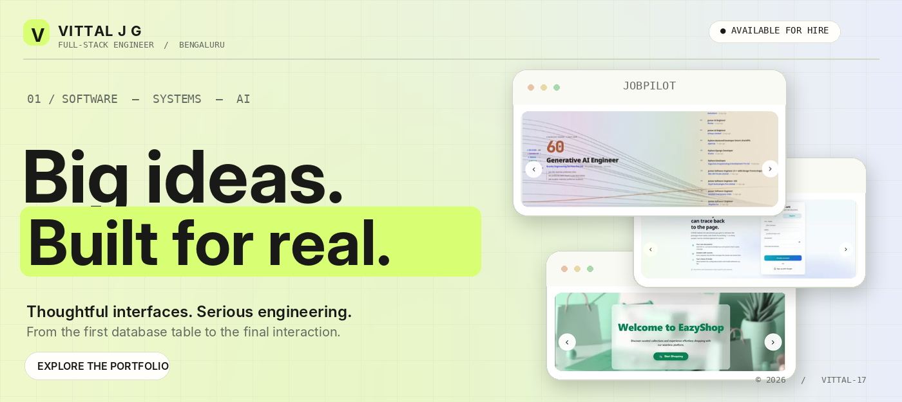
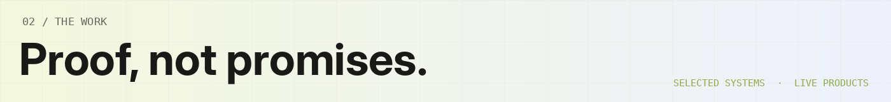
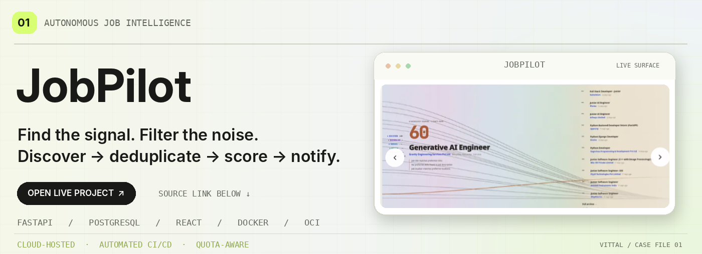
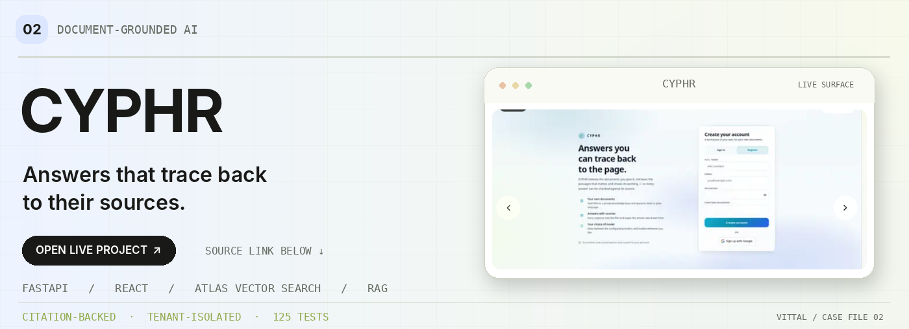
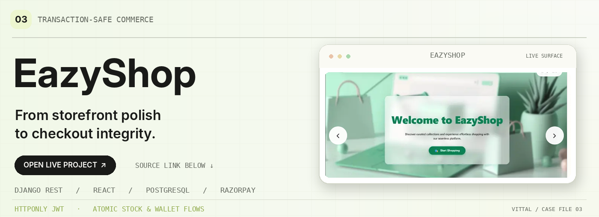
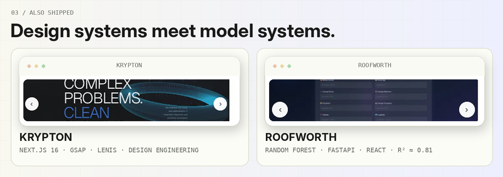
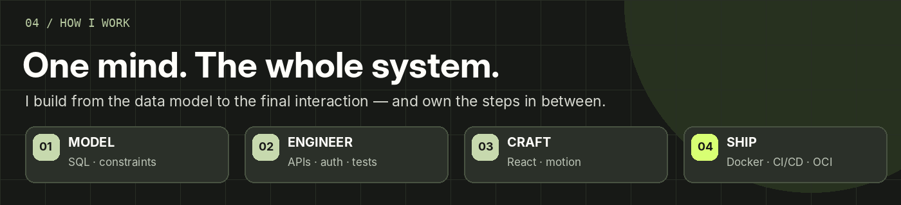
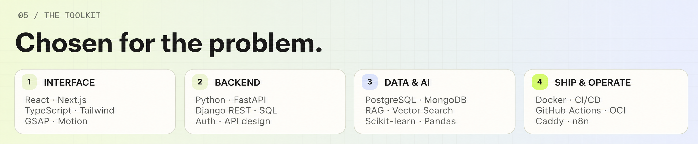
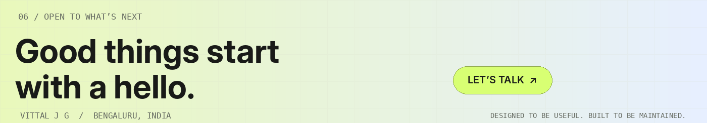

<!--
  VITTAL J G / GITHUB PROFILE · V2 EDITORIAL
  Designed to complement https://vittal-dev.vercel.app/
  Artwork uses genuine screenshots of Vittal’s projects, cropped from his supplied portfolio screenshots.
  Original authored graphics. No paid templates, JavaScript, or external stats endpoints.
-->

  
  

    <a href="https://vittal-dev.vercel.app/"><strong>Portfolio ↗</strong></a> &nbsp; / &nbsp;
    <a href="https://github.com/Vittal-17?tab=repositories"><strong>Repositories ↗</strong></a> &nbsp; / &nbsp;
    <a href="https://www.linkedin.com/in/vittal-dev/"><strong>LinkedIn ↗</strong></a> &nbsp; / &nbsp;
    <a href="mailto:vitthaljg@gmail.com"><strong>Contact ↗</strong></a>
  

  FULL-STACK ENGINEERING · PYTHON BACKENDS · AI / RAG · AUTOMATION · CLOUD

 

**Hey, I’m Vittal.** I build complete software systems — from database design and reliable APIs to expressive interfaces and production delivery. Based in Bengaluru, India, and open to junior engineering roles.

<!-- Each case-file graphic links to a live project. Source code links are beneath it. -->

<strong>JobPilot</strong> · <a href="https://jobpilot.cfd">Live ↗</a> · <a href="https://github.com/Vittal-17/Jobpilot">Source ↗</a> &nbsp;—&nbsp; Discovery, deduplication, enrichment, scoring and alerts.

<strong>CYPHR</strong> · <a href="https://cyphr-rag.vercel.app/">Live ↗</a> · <a href="https://github.com/Vittal-17/CYPHR-RAG">Source ↗</a> &nbsp;—&nbsp; Tenant-aware PDF ingestion, vector search and cited answers.

<strong>EazyShop</strong> · <a href="https://eazyshop.cfd">Live ↗</a> · <a href="https://github.com/Vittal-17/EazyShop">Source ↗</a> &nbsp;—&nbsp; Commerce, Razorpay, stock protection and wallet transactions.

<strong>KRYPTON</strong> · <a href="https://krypton-site.vercel.app/">Live ↗</a> · <a href="https://github.com/Vittal-17/Krypton">Source ↗</a> &nbsp;&nbsp; | &nbsp;&nbsp; <strong>RoofWorth</strong> · <a href="https://aihouseprice.vercel.app/">Live ↗</a> · <a href="https://github.com/Vittal-17/RoofWorth">Source ↗</a>

 

 

<strong>More technical details</strong> — what I actually use and build with

- **Core:** Python, TypeScript, JavaScript, SQL, REST API design, PostgreSQL, MySQL, SQLite, Git and Linux.
- **Web:** FastAPI, Django REST Framework, React, Next.js, Tailwind CSS, JWT, OAuth 2.0 and Alembic.
- **AI / ML:** PDF ingestion, RAG, embeddings, MongoDB Atlas Vector Search, Scikit-learn, Pandas, NumPy and Random Forest regression.
- **Operations:** Oracle Cloud VPS, Docker Compose, Caddy, GitHub Actions CI/CD, GHCR, pytest, database migrations, backup/restore verification and n8n.

**Engineering snapshots:** JobPilot has a tested container-based release workflow on OCI; CYPHR has a 125-test security/regression suite; EazyShop uses database transactions and row locking for consistency; RoofWorth achieved held-out R² ≈ 0.81.

 

  <a href="mailto:vitthaljg@gmail.com"><strong>Email ↗</strong></a> &nbsp;·&nbsp;
  <a href="https://www.linkedin.com/in/vittal-dev/"><strong>LinkedIn ↗</strong></a> &nbsp;·&nbsp;
  <a href="https://vittal-dev.vercel.app/"><strong>Portfolio ↗</strong></a>

