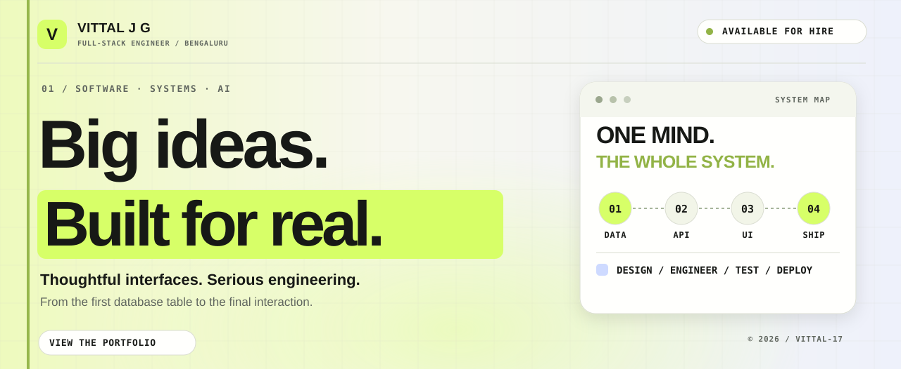
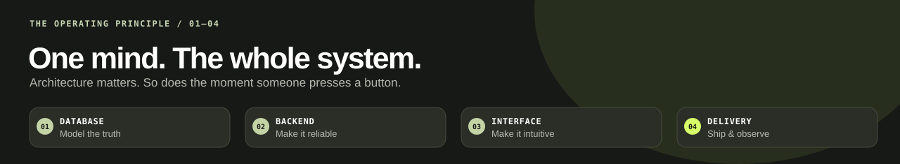
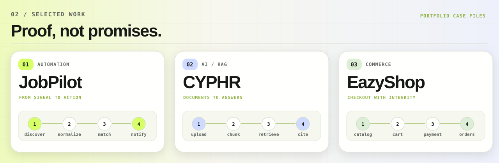
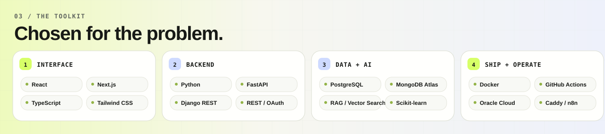

<!--
  VITTAL J G / PROFILE README
  An original, portfolio-inspired design. No GitSkins subscription or export needed.
  The SVG artwork lives in assets/ and renders as ordinary images on GitHub.
  GitHub's Markdown renderer does not support arbitrary webpage CSS or JavaScript.
-->

  
   
   
  <a href="https://vittal-dev.vercel.app/"><b>PORTFOLIO</b></a> &nbsp;·&nbsp;
  <a href="https://github.com/Vittal-17?tab=repositories"><b>GITHUB REPOS</b></a> &nbsp;·&nbsp;
  <a href="https://www.linkedin.com/in/vittal-dev/"><b>LINKEDIN</b></a> &nbsp;·&nbsp;
  <a href="mailto:vitthaljg@gmail.com"><b>LET’S TALK ↗</b></a>
   
  BUILDING COMPLETE SYSTEMS — NOT ISOLATED DEMOS.

 

## `01 / The engineer behind the interface`

**I’m Vittal J G, a junior software developer based in Bengaluru, India.**

I build software from **database design and Python APIs to interfaces, tests, CI/CD, and production deployment**. My work spans full-stack products, document-grounded AI, automation, machine learning, and interaction-focused web experiences.

I care about what happens **behind the button** as much as how it feels to press it. The goal is simple: thoughtful interfaces, reliable systems, and products that make it past the demo stage.

  

 

## `02 / Selected work`

  

### `01` [JobPilot](https://github.com/Vittal-17/Jobpilot) — autonomous job intelligence

**[Live platform ↗](https://jobpilot.cfd)** &nbsp;·&nbsp; **[Source code ↗](https://github.com/Vittal-17/Jobpilot)**

`Python` `FastAPI` `PostgreSQL` `React` `TypeScript` `Docker` `GitHub Actions` `OCI` `Caddy` `n8n`

A deployed job-intelligence platform that **discovers, normalizes, deduplicates, enriches, and scores** software job listings. Built the public-facing feed and private operator workflows, deployed the containerised stack on an Oracle Cloud Linux VPS, and engineered CI/CD around automated tests, verified images, migrations, health checks, and database backup/restore procedures.

### `02` [CYPHR](https://github.com/Vittal-17/CYPHR-RAG) — document-grounded AI, with citations

**[Source code ↗](https://github.com/Vittal-17/CYPHR-RAG)**

`FastAPI` `React` `MongoDB Atlas Vector Search` `Jina Embeddings` `RAG` `OAuth 2.0`

A multi-tenant RAG application that turns uploaded PDFs into **chunked, embedded, searchable knowledge**, then returns **source-cited answers**. Includes user-scoped document and chat isolation, Google OAuth, JWT authentication, runtime LLM selection, and a **125-test** backend security and regression suite.

### `03` [EazyShop](https://github.com/Vittal-17/EazyShop) — commerce with transaction-safe checkout

**[Live platform ↗](https://eazyshop.cfd)** &nbsp;·&nbsp; **[Source code ↗](https://github.com/Vittal-17/EazyShop)**

`Django REST Framework` `React` `PostgreSQL` `Neon` `Razorpay` `Vercel` `Render`

A full-stack commerce platform covering catalogue, cart, wishlist, orders, reviews, gift cards, wallet, payments, and administrative workflows. Includes **HttpOnly-cookie JWT authentication**, server-side Razorpay signature validation, and **atomic database transactions / row-level locks** for inventory and wallet consistency.

### `04` [KRYPTON](https://github.com/Vittal-17/Krypton) — engineering-led digital storytelling

**[Source code ↗](https://github.com/Vittal-17/Krypton)**

`Next.js 16` `TypeScript` `Tailwind CSS 4` `GSAP ScrollTrigger` `Motion` `Lenis` `Vercel`

A responsive Next.js agency website built around an original design system and deliberate motion — parallax sections, staggered reveals, scroll-driven storytelling, and reusable interface architecture.

### `05` [RoofWorth](https://github.com/Vittal-17/RoofWorth) — applied ML, end to end

**[Source code ↗](https://github.com/Vittal-17/RoofWorth)**

`Scikit-learn` `Pandas` `NumPy` `Random Forest` `FastAPI` `React`

An end-to-end California house-price prediction application. Tuned Random Forest regression with cross-validation and GridSearchCV (**held-out R² ≈ 0.81**), exposed inference through FastAPI, and built a React interface with demo mode and prediction history.

Full visual walkthroughs, screenshots, and additional context live on my <a href="https://vittal-dev.vercel.app/">portfolio</a>.

 

## `03 / The toolkit`

  

| Area | Technologies & practices |
| :-- | :-- |
| **Languages** | Python · TypeScript · JavaScript (ES6+) · SQL · Bash · HTML5 · CSS3 |
| **Frontend** | React · Next.js (App Router) · Tailwind CSS · responsive UI · GSAP / Motion |
| **Backend** | FastAPI · Django · Django REST Framework · REST APIs · OAuth 2.0 · JWT · Alembic |
| **Data & AI** | PostgreSQL · MySQL · SQLite · Oracle SQL · MongoDB Atlas · RAG · vector search · Scikit-learn · Pandas · NumPy |
| **Cloud & DevOps** | Oracle Cloud (OCI) · Docker / Compose · GitHub Actions · GHCR · Caddy · Vercel · Render · Neon |
| **Automation & quality** | n8n · pytest · CI/CD · Git · Postman · Linux · unit/integration tests · release verification |

 

## `04 / What I optimize for`

**Ownership end to end.** Schema design, API contracts, auth boundaries, the UI, and production operations should fit together.

**Correctness under pressure.** Transactions, authorization, deterministic workflows, regression tests, and disciplined release processes are first-class engineering work.

**Interfaces with intent.** Motion and design should clarify the product, not distract from it.

 

## `05 / GitHub activity`

  
  

Activity cards use a free independent image API, so they may be temporarily unavailable. Repository-language distribution is not a skills rating.

 

## `06 / Good things start with a hello`

I’m open to **junior software engineering opportunities** across full-stack development, Python/backend engineering, AI/RAG, automation, and cloud-oriented software development.

**[See the full portfolio ↗](https://vittal-dev.vercel.app/)** &nbsp;·&nbsp; **[Connect on LinkedIn ↗](https://www.linkedin.com/in/vittal-dev/)** &nbsp;·&nbsp; **[Email me ↗](mailto:vitthaljg@gmail.com)**

 

  VITTAL J G · BENGALURU, INDIA · DESIGNED TO BE USEFUL. BUILT TO BE MAINTAINED.

