<!--
  VITTAL J G / GITHUB PROFILE · V3 ANIMATED SVG CARDS
  Generated by render_cards.py — DO NOT EDIT BY HAND
  Source: https://vittal-dev.vercel.app/
-->

<!-- 01 hero -->

<!-- 02 links row — three tiles at 32.5% each, inline so they sit side-by-side -->
&nbsp;&nbsp;

<!-- 03 chart -->

<!-- 04 repos -->

<!-- 05 contribution graph -->

  <a href="https://vittal-dev.vercel.app/"><strong>Portfolio ↗</strong></a> &nbsp;/&nbsp;
  <a href="https://github.com/Vittal-17?tab=repositories"><strong>Repositories ↗</strong></a> &nbsp;/&nbsp;
  <a href="https://www.linkedin.com/in/vittal-dev/"><strong>LinkedIn ↗</strong></a> &nbsp;/&nbsp;
  <a href="mailto:vitthaljg@gmail.com"><strong>Contact ↗</strong></a>

FULL-STACK ENGINEERING · PYTHON BACKENDS · AI / RAG · AUTOMATION · CLOUD
