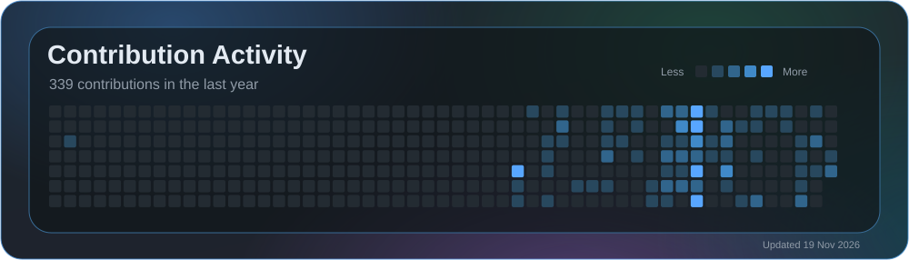

<h1 align="center">Hey, I'm Vittal!</h1>

  

## About me

I build software wherever the problem takes me—across AI systems, machine learning, automation, cloud infrastructure, Python backends and web applications.

My projects range from document-grounded AI and prediction services to e-commerce and autonomous job intelligence. I take ownership from architecture through production: building the interfaces, connecting the systems, testing the edge cases, and deploying and operating what I ship.

## A few things I've shipped

<table>
  <tr>
    <td width="24%"><a href="https://github.com/Vittal-17/Jobpilot"><b>Jobpilot ↗</b></a></td>
    <td>Job discovery, enrichment, scoring, and alerts FastAPI · React · PostgreSQL</td>
  </tr>
  <tr>
    <td width="24%"><a href="https://github.com/Vittal-17/CYPHR-RAG"><b>CYPHR-RAG ↗</b></a></td>
    <td>Document-grounded AI with cited answers FastAPI · Next.js · MongoDB Atlas</td>
  </tr>
  <tr>
    <td width="24%"><a href="https://github.com/Vittal-17/EazyShop"><b>EazyShop ↗</b></a></td>
    <td>E-commerce with payments, wallets, and stock protection Django REST · React · PostgreSQL</td>
  </tr>
  <tr>
    <td width="24%"><a href="https://github.com/Vittal-17/Krypton"><b>Krypton ↗</b></a></td>
    <td>An agency website with expressive layouts and motion Next.js · Tailwind CSS</td>
  </tr>
  <tr>
    <td width="24%"><a href="https://github.com/Vittal-17/RoofWorth"><b>RoofWorth ↗</b></a></td>
    <td>Machine learning for house price prediction Python · Scikit-learn · Flask</td>
  </tr>
</table>

[More on my portfolio ↗](https://vittal-dev.vercel.app/)

## GitHub stats & activity

  <picture>
    <source media="(max-width: 600px)" srcset="./cards/activity-mobile.svg"/>
    
  </picture>

  <picture>
    <source media="(max-width: 600px)" srcset="./cards/languages-mobile.svg"/>
    
  </picture>

## Languages & tools

### Programming languages

  &nbsp;
  &nbsp;
  &nbsp;

### Frontend

  &nbsp;
  &nbsp;
  &nbsp;
  &nbsp;
  &nbsp;
  &nbsp;

### Backend

  &nbsp;
  &nbsp;
  &nbsp;
  &nbsp;

### Databases

  &nbsp;
  &nbsp;
  &nbsp;
  &nbsp;
  &nbsp;

### DevOps & cloud

  &nbsp;
  &nbsp;
  &nbsp;
  &nbsp;
  &nbsp;
  &nbsp;

### Machine learning

  &nbsp;
  &nbsp;

Random Forest · GridSearchCV

### Tools

  &nbsp;
  &nbsp;
  &nbsp;
  &nbsp;

## Connect with me

  <a href="https://www.linkedin.com/in/vittal-dev/">&nbsp;LinkedIn</a> &nbsp;·&nbsp;
  <a href="mailto:vitthaljg@gmail.com">&nbsp;Email</a> &nbsp;·&nbsp;
  <a href="https://vittal-dev.vercel.app/">&nbsp;Portfolio</a>

  <picture>
    <source media="(max-width: 600px)" srcset="./cards/snake-mobile.svg"/>
    
  </picture>

  Pixel art: <a href="https://www.behance.net/gallery/176249761/Late-Sleep">Late Sleep by Kirokaze</a>

